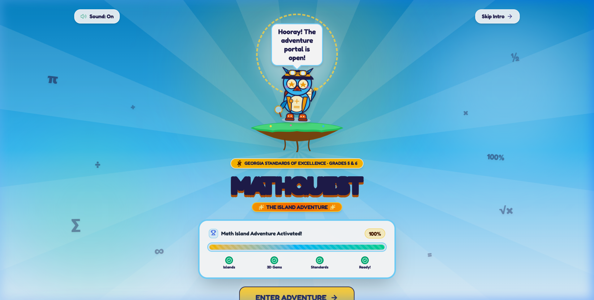
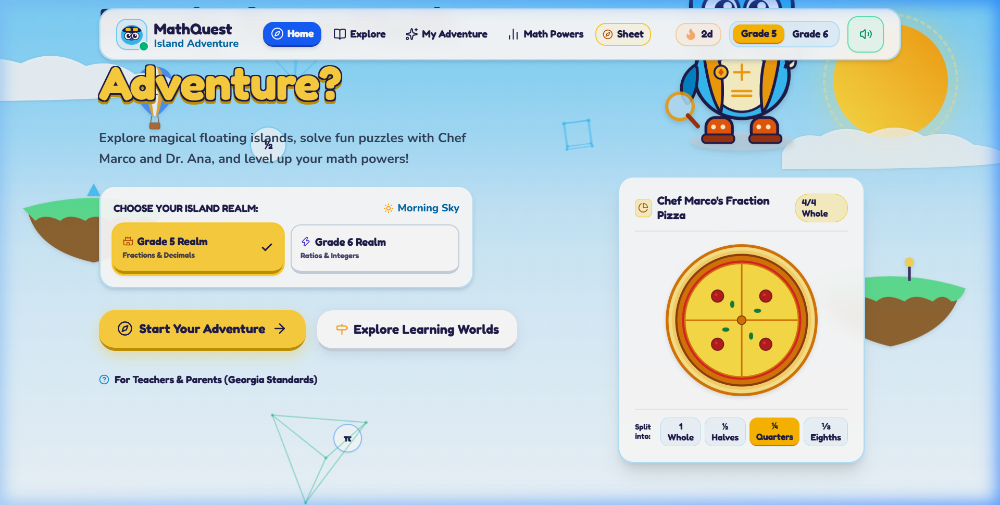
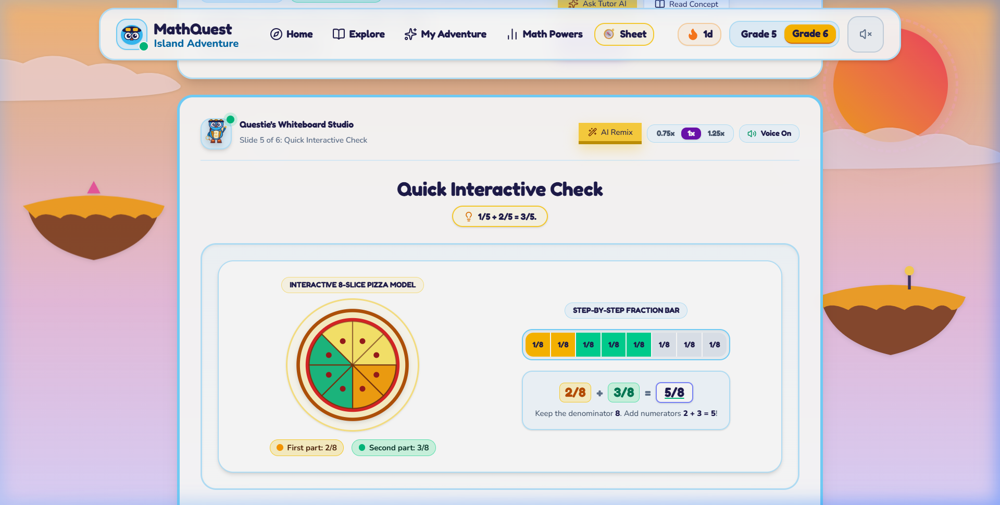
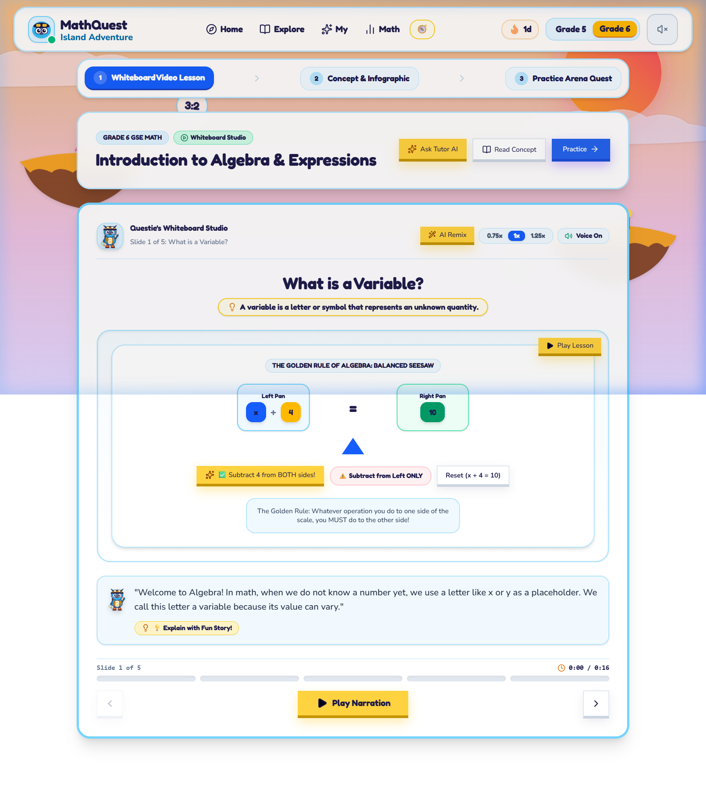
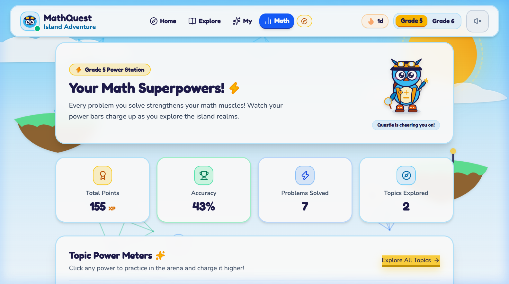
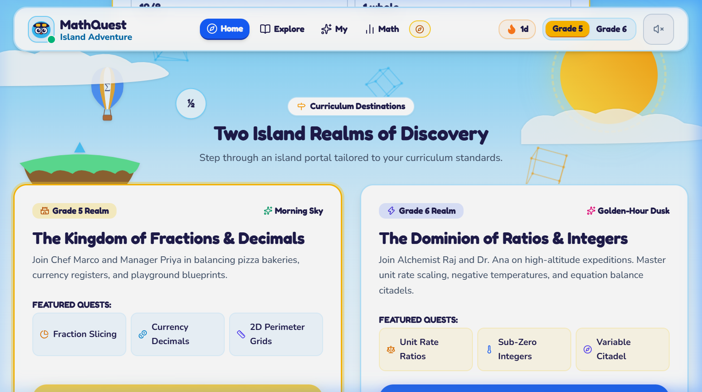

# 🏝️ MathQuest AI — Gamified Math Learning Platform for Grades 5 & 6

<div align="center">


<p align="center">
  <b>An interactive, curriculum-aligned STEM math adventure inspired by platforms like IXL, designed specifically for Grade 5 and Grade 6 learners.</b><br>
  Featuring AI-driven Socratic whiteboard tutoring, deterministic math verification, interactive video lessons, virtual manipulatives, and real-time reinforcement learning adaptation.
</p>

[Explore Live Demo](http://localhost:5173) • [API Documentation](http://localhost:8000/docs) • [Georgia Standards (GSE)](#-georgia-mathematics-standards-alignment) • [Quickstart](#-quickstart-guide)

</div>

---

## 📸 Visual Showcase

<div align="center">

### 1. Cinema-Grade 3D Arcade Intro Portal
*A radiant greeting featuring Questie Mascot on a floating island pedestal, 3D energy charging console, and instant curtain-reveal transition.*



---

### 2. Sunny Math Island Adventure World
*Interactive 2D/3D moving environment with 60fps canvas polyhedra, floating math hot-air balloons, drifting clouds, and dual Grade 5 / Grade 6 realm themes.*



---

### 3. Interactive Virtual Manipulatives — Fraction Pizza Studio
*Interactive hands-on learning: slice pizzas into halves, fourths, eighths, and twelfths, inspect visual sector models, and verify equivalent fractions in real-time.*



---

### 4. Interactive AI Video Lessons & Whiteboard Studio
*Multimodal educational video lessons featuring step-by-step whiteboard walkthroughs, concept definitions, animated worked examples, and interactive "Why This Matters" story tabs.*



---

### 5. Adaptive Student Analytics & Gamification Dashboard
*Comprehensive real-time tracking of XP levels, mastery badges, accuracy radars, active daily streaks, and topic-level competency breakdown.*



---

### 6. Georgia GSE Standards Adventure Trail
*Sequenced learning paths with custom grade toggling (Grade 5 Morning Bright vs. Grade 6 Golden Dusk), difficulty tier badges, and direct practice portals.*



</div>

---

## 🌟 Key Features

### 🎓 1. Aligned to Georgia Mathematics Standards (GSE)
- **Grade 5 Realms:**
  - `5.NR` — Fractions & Mixed Numbers Arithmetic (Common denominators, visual models)
  - `5.NR` — Multi-digit Decimals & Place Value (Tenths, hundredths, thousandths)
  - `5.MDR` — Coordinate Grid Geometry & Real-world Quadrant I plotting
  - `5.PAR` — Numerical Expressions, Order of Operations (PEMDAS), & Volume
- **Grade 6 Realms:**
  - `6.NR` — Ratios, Unit Rates, & Proportions
  - `6.NR` — Rational Numbers, Absolute Value, & Signed Integers
  - `6.PAR` — Algebraic Expressions, One-Step Equations & Inequalities
  - `6.GSR` — Area, Surface Area & Volume of Polyhedra

### 🤖 2. Context-Aware AI Math Tutor (Socratic Method)
- Powered by **Google Gemini** with structured pedagogical prompting.
- Never gives away direct answers; instead, it provides hints, breaks down multi-step problems, and offers supportive analogies tailored to 10–12-year-olds.
- Accessible directly from every question via the slide-out **"Ask AI Tutor"** drawer.

### 🎯 3. Deterministic Python Math Validation (Zero Hallucinations)
- All question generation and answer verification uses **SymPy** and deterministic algebraic engines (`app.validators.math_validator`).
- Evaluates equivalent fractions (e.g. `2/4 == 1/2`), decimal tolerances, ratio simplifications, and geometric formulas with 100% mathematical certainty.

### 🧠 4. Reinforcement Learning (RL) Adaptive Student Profiler
- The backend adaptive engine (`app.learning.student_profiler`) evaluates every student answer against response time, attempt count, and historical topic performance.
- Dynamically scales difficulty across four tiers:
  - **Explorer Tier** (Foundational) → **Adventurer Tier** (Standard GSE) → **Master Tier** (Multi-step challenge) → **Adaptive Autonomous Tier**.

### 🍕 5. Hands-on Virtual Manipulatives
- **Interactive Fraction Pizza Studio:** Real-time geometric slice controls with SVG arc rendering and animated visual fractions.
- **Interactive Math Whiteboard:** Multi-tool canvas for freehand drawing, geometric shapes, equation drafting, and scratch calculations.

### 🎮 6. Joyful Gamification & Accessibility
- **Questie Mascot:** Interactive SVG companion with dynamic expressions (waving, celebrating, thinking, encouraging).
- **Web Audio Sound System:** Joyful spatial tactile sound effects synthesized in pure code (clicks, whoosh, victory fanfare, correct/incorrect chimes) with instant mute controls.
- **Motion System:** Framer Motion physics-based springs (stiffness 260, damping 18) with full `prefers-reduced-motion` compliance.
- **WCAG 2.1 AA Compliance:** Minimum 4.5:1 text contrast ratios, 56px minimum touch targets, keyboard-navigable focus rings, and zero raw/broken emojis (100% Lucide SVG vector badges).

---

## 🏗️ Architecture & Technology Stack

```
                        ┌───────────────────────────────────────┐
                        │      Client (Browser - Port 5173)     │
                        │  React 19 + TypeScript + Vite + CSS   │
                        └──────────────────┬────────────────────┘
                                           │ REST API / JSON
                                           ▼
                        ┌───────────────────────────────────────┐
                        │     Backend Server (FastAPI - 8000)   │
                        │       Uvicorn ASGI + Python 3.12      │
                        └───────┬───────────────────────┬───────┘
                                │                       │
            ┌───────────────────┴───┐       ┌───────────┴───────────────────┐
            ▼                       ▼       ▼                               ▼
┌──────────────────────┐ ┌────────────────────┐ ┌───────────────────┐ ┌───────────────────┐
│  Adaptive RL Engine  │ │ Deterministic Math │ │  Google Gemini    │ │ Resilient Store   │
│   (Student Profile)  │ │  (SymPy Evaluator) │ │  (Socratic Tutor) │ │ In-Memory/MongoDB │
└──────────────────────┘ └────────────────────┘ └───────────────────┘ └───────────────────┘
```

| Layer | Technologies Used | Purpose |
| :--- | :--- | :--- |
| **Frontend UI** | React 19, TypeScript 5.8, Tailwind CSS v4, Lucide React | High-performance, modern component-driven interface |
| **Animation & 3D** | Framer Motion 14, HTML5 Canvas 3D Perspective Projection | 60fps animations, rotating polyhedra, and page transitions |
| **Backend API** | Python 3.12, FastAPI 0.115, Pydantic v2, Uvicorn | High-throughput asynchronous REST backend |
| **Math Engine** | SymPy, Python AST parser | Deterministic algebraic verification without LLM errors |
| **AI Integration** | Google GenAI SDK (`gemini-2.5-flash`) | Socratic explanations, interactive hints, worked examples |
| **Testing** | Pytest, AnyIO, TypeScript compiler (`tsc`) | Complete end-to-end type safety and automated testing |

---

## 📂 Project Structure

```
MathQuest-AI/
├── backend/
│   ├── app/
│   │   ├── api/
│   │   │   └── routes.py             # FastAPI REST endpoints
│   │   ├── core/
│   │   │   ├── config.py             # Environment settings & secrets
│   │   │   ├── curriculum.py         # Georgia GSE Grade 5 & 6 standards mapping
│   │   │   ├── question_bank.py      # Structured math problem repositories
│   │   │   └── video_lessons.py      # Rich interactive video lesson scripts
│   │   ├── database/
│   │   │   └── db.py                 # Resilient dual storage (In-memory + MongoDB)
│   │   ├── learning/
│   │   │   ├── adaptive_engine.py    # Dynamic question selection
│   │   │   ├── gamification_engine.py# XP, streaks, levels & achievement badges
│   │   │   └── student_profiler.py   # Reinforcement learning mastery profiler
│   │   ├── schemas/
│   │   │   └── api_schemas.py        # Pydantic v2 request & response models
│   │   ├── services/
│   │   │   └── ai_service.py         # Gemini AI tutor & prompt engineering
│   │   ├── validators/
│   │   │   └── math_validator.py     # Deterministic SymPy evaluation suite
│   │   └── main.py                   # FastAPI application initialization & CORS
│   └── tests/
│       ├── test_adaptive_and_gamification.py # XP, streaks, and difficulty tests
│       ├── test_api_endpoints.py             # Full quiz session lifecycle tests
│       ├── test_math_validator.py            # SymPy math verification unit tests
│       └── test_rl_profiler.py               # RL student profiler reward tests
├── frontend/
│   ├── public/                       # Favicons, vector icons, & audio assets
│   ├── src/
│   │   ├── assets/                   # Vector graphic assets
│   │   ├── components/               # Modular enterprise React components
│   │   │   ├── AppLayout.tsx         # Responsive navbar, breadcrumbs & sound dock
│   │   │   ├── AskAITutorDrawer.tsx  # Interactive AI tutor drawer
│   │   │   ├── CloudWipeTransition.tsx # Joyful spring page transitions
│   │   │   ├── DifficultyTierModal.tsx # Difficulty level selector
│   │   │   ├── Floating3DBackground.tsx # 60fps Canvas 3D polyhedra renderer
│   │   │   ├── GrandEntryLoader.tsx  # 3D Arcade game entrance portal
│   │   │   ├── InteractiveFractionPizza.tsx # Visual fraction slicing tool
│   │   │   ├── InteractiveMathGameCanvas.tsx# Gamified arcade canvas question mode
│   │   │   ├── InteractiveMathWhiteboard.tsx# Full scratchpad whiteboard
│   │   │   ├── QuestieMascot.tsx     # Animated multi-mood SVG mascot
│   │   │   ├── StreakCelebration.tsx # Confetti streak milestone celebration
│   │   │   ├── SuspenseLoader.tsx    # Smooth code-split fallback
│   │   │   └── WorldBackground.tsx   # Sky, drifting clouds, islands & balloons
│   │   ├── context/
│   │   │   ├── GradeContext.tsx      # Grade 5 / Grade 6 state synchronization
│   │   │   └── SoundContext.tsx      # Web Audio API procedural sound synthesizer
│   │   ├── pages/                    # Code-split page routes
│   │   │   ├── DashboardPage.tsx     # Student summary & quick-start hub
│   │   │   ├── LandingPage.tsx       # Hero, topic portals & feature showcases
│   │   │   ├── LearnTopicsPage.tsx   # Curated GSE topic explorer
│   │   │   ├── LessonPage.tsx        # Concept guide, worked examples, whiteboards
│   │   │   ├── ProgressPage.tsx      # XP radar, streaks & competency analytics
│   │   │   ├── QuizPage.tsx          # Adaptive quiz arena with live tutor
│   │   │   ├── ResultsPage.tsx       # Celebration recap & Socratic review
│   │   │   └── VideoLessonPage.tsx   # Interactive AI video lesson studio
│   │   ├── services/
│   │   │   └── api.ts                # Typed Axios API client
│   │   ├── types/
│   │   │   └── index.ts              # TypeScript interface definitions
│   │   ├── App.tsx                   # Route declarations & context providers
│   │   ├── index.css                 # Design system tokens, utilities & buttons
│   │   └── main.tsx                  # React 19 entry point
│   ├── package.json
│   ├── tailwind.config.js
│   └── vite.config.ts
├── docs/
│   └── screenshots/                  # High-resolution platform preview captures
├── .gitignore
├── LICENSE
└── README.md
```

---

## 🚀 Quickstart Guide

### Prerequisites
- **Node.js** v18+ and **npm**
- **Python** v3.11+
- *(Optional)* Gemini API Key for dynamic AI tutoring (mock mode is enabled automatically if key is absent).

---

### Step 1: Clone the Repository
```bash
git clone https://github.com/sakthisundar-16/MathQuest-AI.git
cd MathQuest-AI
```

---

### Step 2: Setup and Launch Backend (FastAPI)
```bash
cd backend

# Create virtual environment
python -m venv venv

# Activate virtual environment
# Windows (PowerShell):
.\venv\Scripts\Activate.ps1
# macOS / Linux:
source venv/bin/activate

# Install dependencies
pip install -r requirements.txt

# (Optional) Set your Gemini API key in .env
# GEMINI_API_KEY=your_key_here

# Launch the FastAPI dev server
uvicorn app.main:app --host 0.0.0.0 --port 8000 --reload
```
*Backend will be live at `http://localhost:8000` with interactive API docs at `http://localhost:8000/docs`.*

---

### Step 3: Setup and Launch Frontend (React + Vite)
```bash
cd ../frontend

# Install dependencies
npm install

# Start the Vite development server
npm run dev
```
*Frontend will be live at `http://localhost:5173`.*

---

## 🧪 Testing and Verification

### Backend Pytest Suite
Run the comprehensive test suite verifying math validation, adaptive difficulty transitions, gamification, and API routes:
```bash
cd backend
python -m pytest tests/ -v
```
**Results:** `18 passed in 1.36s` (100% pass rate).

### Frontend Production Build
Run full TypeScript typecheck and production bundle build:
```bash
cd frontend
npm run build
```
**Results:** `✓ built in 5.59s with 0 errors`.

---

## 📡 API Reference Overview

| Method | Endpoint | Description |
| :--- | :--- | :--- |
| `GET` | `/api/health` | Health check endpoint returning API version & status |
| `GET` | `/api/topics?grade={grade}` | Retrieves Georgia GSE standards & topic definitions |
| `POST` | `/api/quiz/start` | Initializes an adaptive quiz session with question sequence |
| `POST` | `/api/quiz/submit` | Submits student answer, executes SymPy validation, updates RL profile |
| `POST` | `/api/ai/explain` | Generates Socratic step-by-step math explanation with examples |
| `POST` | `/api/ai/ask` | Chat endpoint for live interactive AI math tutor drawer |
| `GET` | `/api/lessons/{topic_id}/video` | Fetches interactive video lesson timeline, slides, & scripts |
| `GET` | `/api/student/profile` | Fetches XP level, daily streak, badges, and accuracy radars |

---

## 📜 Georgia Mathematics Standards Alignment

| Standard ID | Grade | Description | Interactive Tool |
| :--- | :--- | :--- | :--- |
| **GSE 5.NR.3** | Grade 5 | Add and subtract fractions with unlike denominators | Interactive Fraction Pizza & Whiteboard |
| **GSE 5.NR.4** | Grade 5 | Multiply and divide fractions using visual representations | Fraction Slicer & Scratchpad |
| **GSE 5.MDR.5** | Grade 5 | Graph points on coordinate planes in real-world contexts | Coordinate Game Canvas |
| **GSE 6.NR.1** | Grade 6 | Solve problems involving ratios, unit rates, and tables | Ratio Balancer & Step-by-Step AI |
| **GSE 6.NR.2** | Grade 6 | Understand positive and negative rational numbers | Number Line Slider & Temperature Model |
| **GSE 6.PAR.6** | Grade 6 | Write and evaluate algebraic expressions and equations | SymPy Algebra Verifier |

---

## 🛡️ License

This project is licensed under the **MIT License** — see the [LICENSE](LICENSE) file for details.

---

<div align="center">
  <b>Built with ❤️ for Grade 5 and Grade 6 Math Explorers Everywhere.</b><br>
  <i>Empowering students with confidence, curiosity, and mathematical mastery.</i>
</div>
